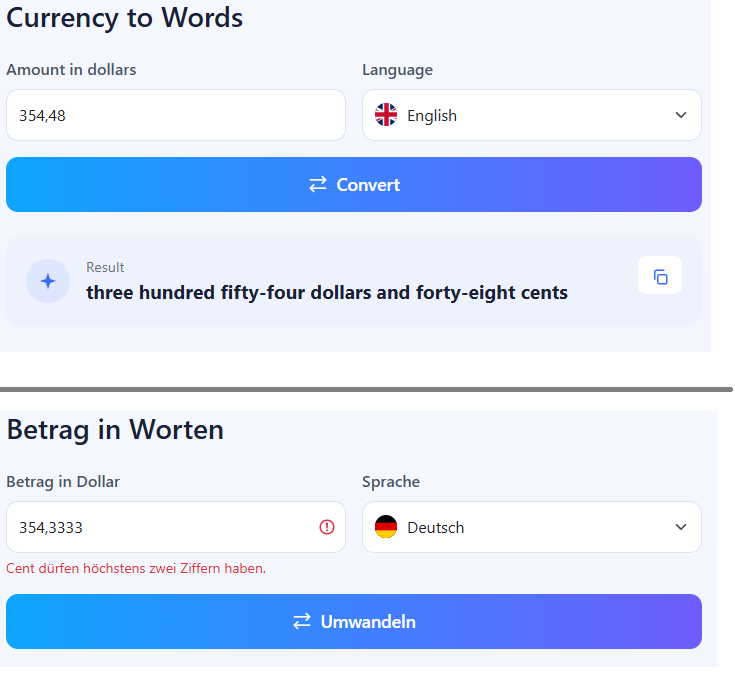

# Currency to Words

Converts a dollar amount into words, in English or German.

**Live:** https://currency-into-words.onrender.com
It runs on Render's free tier. After 15 minutes without visitors the service sleeps, so the first request can take 15–30 seconds.

Built with .NET 10: an ASP.NET Core minimal API does the conversion, and a Blazor WebAssembly client runs in the browser.



## Build and run

You need the .NET 10 SDK.

**Build:**

```bash
dotnet build
```

This builds all six projects from `CurrencyToWords.slnx`. `dotnet run` and `dotnet test` also build on their own, so the commands below work without this step.

**Visual Studio:** open `CurrencyToWords.slnx` and start the **API + Web** profile. The client opens on http://localhost:5140 and calls the API on http://localhost:5085.

**Command line:** run each project in its own terminal.

```bash
dotnet run --project src/CurrencyToWords.Api --launch-profile http
dotnet run --project src/CurrencyToWords.Web --launch-profile http
```

Then open http://localhost:5140.

**Tests:**

```bash
dotnet test
```

**As it runs in production** (needs Docker, on the `hosting` branch):

```bash
git switch hosting
docker build -t currency-to-words .
docker run -p 8080:8080 currency-to-words
```

Then open http://localhost:8080. Page and API come from the same container.

## API

```http
POST /api/convert
Content-Type: application/json

{ "amount": "25,1", "language": "de" }
```

```json
{ "words": "fünfundzwanzig Dollar und zehn Cent" }
```

| Status | When |
|---|---|
| 200 | converted |
| 400 | invalid amount (`title: "Invalid amount"`) or unsupported language. `detail` holds a message for the user, in the requested language. |
| 413 | request body over 4 KB |
| 500 | unexpected error. The response is generic; details go only to the server log. |

`amount` is a string, not a number.

## Architecture

```
src/
  CurrencyToWords.Core        parser and the two converters, plain C#
  CurrencyToWords.Contracts   request and response records
  CurrencyToWords.Api         minimal API, one endpoint
  CurrencyToWords.Web         Blazor WebAssembly client
tests/
  CurrencyToWords.Core.Tests
  CurrencyToWords.Api.Tests
```

```
Web ──→ Contracts ←── Api ──→ Core
```

Web doesn't reference Core. The browser never gets the conversion code, so conversion can only happen on the server.

## Design decisions

- **One converter per language** behind `ICurrencyToWordsConverter`. The API gets all converters from DI and picks one by language code.
- **Input parsing lives in Core** (`AmountParser`), next to the rules it enforces. It throws `FormatException` with a message from `ValidationMessages.resx` or `ValidationMessages.de.resx`, so validation errors come in the user's language.
- **User errors and program errors are kept apart.** Bad input gives a 400 with a message meant for the user. Anything else gives a generic 500, and only the log sees the exception.
- **Request and response types are shared** through the Contracts project, so client and API can't drift apart.
- **Security:** requests over 4 KB are refused before they're read.
- **Deployment as one service:** on the `hosting` branch the API also serves the client's files, so the site has one address and needs no CORS. It's still client-server: the client runs in the browser and calls `/api/convert` over HTTP.

## Input and output rules

| Rule | Example |
|---|---|
| A comma separates dollars and cents; one decimal digit means tenths | `25,1` → ten cents |
| Any whitespace is ignored, wherever it is | `45 100`, `4 5100` and `25, 1` are all accepted |
| More than two decimals is rejected, not rounded | `25,999` → error |
| Leading zeros are allowed | `007` → seven dollars |
| Maximum 999 999 999 dollars and 99 cents | `1 000 000 000` → error |
| English follows the task's examples: lowercase, hyphenated tens, no "and" after hundred | `one hundred one dollars` |
| German writes everything below a million as one word; `Dollar` and `Cent` have no plural | `fünfundvierzigtausendeinhundert Dollar` |
| German "one" is `ein` before Dollar and Cent, `eine` before Million, and `eins` at the end of a longer number | `ein Dollar`, `eine Million`, `einhunderteins Dollar`, `einhunderteins Millionen` |

## Tests

- **Core.Tests (75):** the parser with valid input, every error message in both languages and the language fallback; both converters, including every example from the task; the range checks of `CurrencyAmount`.
- **Api.Tests (5):** each test calls the real endpoint over HTTP. Both languages (200), invalid amount and unsupported language (400), and an oversized body (413).

Not automated: the UI, which was tested by hand, and the 500 path.

## Known limitations

- No rate limiting.
- A body over 4 KB gets 413, which the UI shows as the general "service not available" message.
- The "unsupported language" message and Blazor's own error banner are English only.
- The first visit downloads the .NET runtime for WebAssembly (a few MB), on top of the free tier's wake-up time.

## Deployment

The `hosting` branch adds what the live site needs on top of `master`: the API serves the client, a `Dockerfile`, and the security headers. Render deploys every push to `hosting`.

## Adding a language

1. A converter in Core that implements `ICurrencyToWordsConverter`, with its own tests
2. `ValidationMessages.<code>.resx` with the translated error messages
3. Register the converter in `Api/Program.cs`
4. Add the language to the list in `Web/Components/LanguageSelect.razor`, plus a flag at `wwwroot/img/flag-<code>.svg`
5. Add the page texts in `Web/Pages/Home.razor`, which currently chooses between English and German with a simple check
